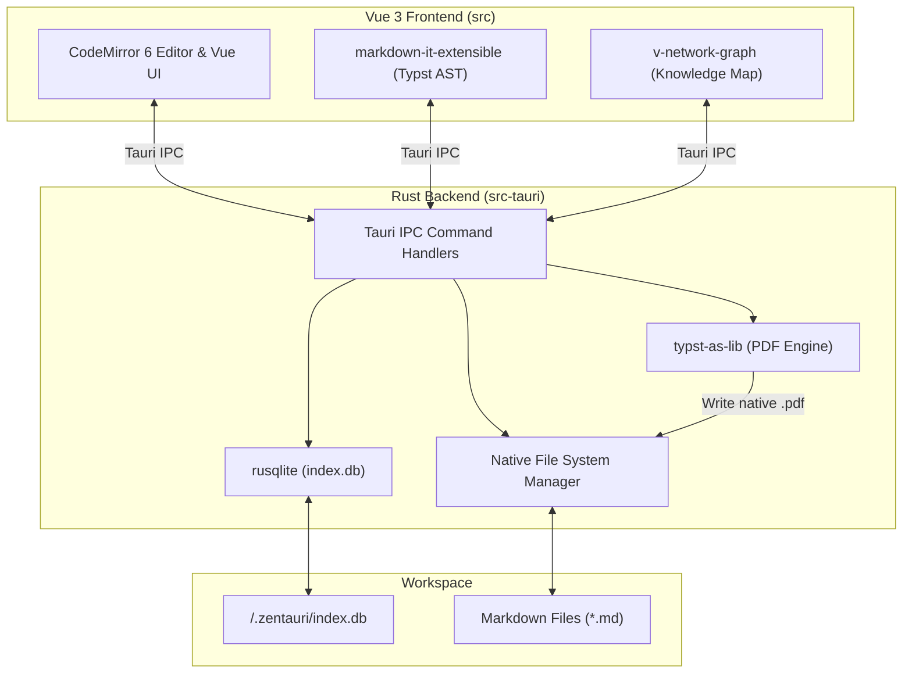

# 📐 System-Architektur

Zentauri basiert auf einem strikten **Rust-First**- und **Tauri-Native**-Ansatz. Dies garantiert maximale Performance, Speichersicherheit und Zukunftssicherheit für WebAssembly und moderne Rust-Toolchains.

---

## 1. Grundprinzipien

- **Kein schweres Node.js-Ökosystem:** Wir vermeiden schwere Node.js-Libraries (wie Playwright oder Electron) für Backend-Operationen.
- **Rust Backend (`src-tauri`):** Sämtliche Dateisystem-Operationen, Workspace-Indexierungen und Datenextraktionen erfolgen nativ in Rust.
- **Dumb UI (`src`):** Das Vue 3 Frontend fungiert als reine Präsentationsschicht und kommuniziert über schlanke Tauri IPC-Befehle mit dem Backend.

---

## 2. Komponenten-Topologie

---

## 3. Datenbank & Indexierung

Zentauri verwaltet eine lokale SQLite-Datenbank (`.zentauri/index.db`) innerhalb jedes geöffneten Workspaces:

- **`files`**: Speichert Dateipfade, Ordnerstrukturen, Zeitstempel und Dateigrößen.
- **`markdown_metadata`**: Speichert extrahiertes YAML-Frontmatter wie `title`, `tags`, `iast` und `devanagari`.
- **`markdown_links`**: Bildet `[[Wiki-Links]]` und Standard-Links als Indexbasis ab (interaktive Graph-Oberfläche geparkt auf der [Roadmap](./roadmap)).

---

## 4. Nativer Typst PDF-Export (Aktiv)

Zentauri verzichtet vollständig auf Headless-Chromium-Engines oder Node.js-DTP-Werkzeuge zugunsten eines nativen Rust-Satzes. Über **Typst** (`typst-as-lib`, `typst-pdf`) im Tauri-Backend (`export_pdf`-IPC-Kommando, Tastaturkürzel `⌘P`) wird aus dem Markdown-Quelltext ein Typst-Dokument generiert und in Millisekunden direkt zu einem druckfertigen PDF mit STIX Two Text und Noto Serif Devanagari kompiliert – ohne externe CLI-Abhängigkeiten.

---

## 5. Sanskrit-Eingabesteuerung (Hybrid-Architektur)

Für indologische Mischtexte (Deutsch/Englisch + IAST/Devanāgarī) verfolgt Zentauri ein dreistufiges Hybrid-Konzept auf Applikationsebene statt fehleranfälliger OS-Tastaturlayouts oder reinem ASCII-Harvard-Kyoto:

1. **Kanonische Speicherung (Aktiv):** Persistenz im Markdown-Quelltext immer in standardkonformem IAST (`kṛṣṇaḥ`) oder Devanāgarī (`कृष्णः`).
2. **In-Editor IME (Roadmap / Backlog für v2.0.0):** Automatische Scope-basierte Live-Transliteration aus Harvard-Kyoto innerhalb von `《...》` und `⟪...⟫` sowie Compose-Sequenzen für den Fließtext.
3. **Post-Hoc Tooling (Aktiv):** Globale Tastaturkürzel (`⌥⌘D`, `⌥⌘H`) und Toolbar-Schalter mit tag-sicherem Parsing zur schnellen Wandlung markierter Abschnitte.

Ausführliche Spezifikation und Entscheidungsmatrix siehe: [Sanskrit-Eingabearchitektur](./scholarly-input-architecture.md) und [Roadmap & Backlog](./roadmap).

---

## 6. Work-Modes Architektur (Philologische Desktop-Suite)

Um Feature-Creep im Kern-Editor zu vermeiden und gleichzeitig den vielfältigen Anforderungen von Editionsprojekten gerecht zu werden, gliedert sich Zentauri in drei zuschaltbare **Work-Modes** in der Activity-Bar:

1. **Modus 1: Markdown Authoring (Aktiv)**
   - Einzelfenster- und Split-Pane-Textverfassung (CodeMirror 6).
   - Sanskrit-Klammer-Hervorhebung, KaTeX-Formeln und nativer Typst-PDF-Export.
2. **Modus 2: Synoptische Master-JSON Edition (Roadmap v2.1.0)**
   - Spezialisierter Split-Pane-Editor für historische Editionen (`book.json` / AST-Format wie in `brhadaranyaka`).
   - Kopplung von Scan-PDFs mit segmentierten Eingabefeldern (Devanāgarī, IAST, Übersetzung, Apparat) zur automatischen Kompilierung nach TEI-P5 XML und Typst-PDF.
3. **Modus 3: Dual PDF QA & Proofing (Aktiv Kern / Roadmap v2.0.0)**
   - 2-spaltiger Vektor-PDF-Vergleich (`hayro_svg`) mit synchronem Scroll-Lockstep, SWAP-Seitenwechsel und CLI-/Finder-Integration.
   - Visuelle Bounding-Box-Annotationen, 1-Klick-Review-Prompt für KIs und annotierter PDF-Export geplant für Version 2.0.0.
