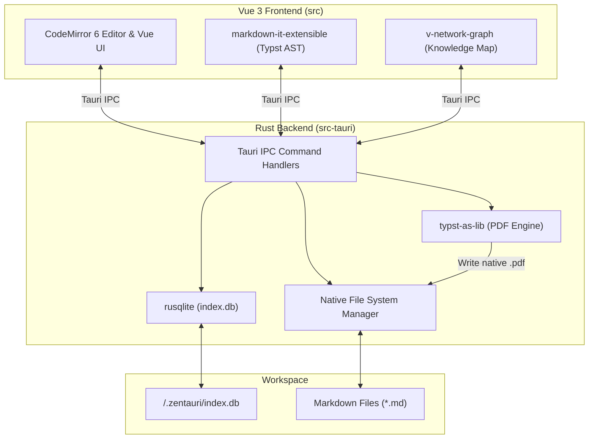

# 📐 System Architecture

Zentauri adopts a strict **Rust-First** and **Tauri-Native** approach. This guarantees maximum performance, memory safety, and future-proof compatibility with WebAssembly and advanced Rust toolchains.

---

## 1. Core Principles

- **No Heavy Node.js Ecosystem:** We avoid heavy Node.js libraries (like Playwright or Electron) for backend operations.
- **Rust Backend (`src-tauri`):** All file-system operations, workspace indexing, and data extractions happen natively in Rust.
- **Dumb UI (`src`):** The Vue 3 frontend acts strictly as a presentation layer and relies on Tauri IPC commands for data access.
- **Dual Data Architecture (Plain Text & Master-JSON):** Linear prose (essays, lesson notes) is canonically stored in Markdown (Mode 1). Segmented historical corpora and dictionary entries (editions like Böhtlingk or Bṛhadāraṇyaka) are canonically stored and edited as structured Master-JSON (`book.json` / Mode 2). External formats (TEI-P5 XML, Typst-PDF, publisher `.docx`) are strictly downstream compilation targets.

---

## 2. Component Topology

---

## 3. Database & Indexing

Zentauri maintains a local SQLite database (`.zentauri/index.db`) within each open workspace. This allows for lightning-fast queries and powers advanced features:

- **`files`**: Tracks file paths, directory structures, timestamps, and sizes.
- **`markdown_metadata`**: Stores parsed YAML frontmatter like `title`, `tags`, `iast`, and `devanagari` values for scholarly lookup.
- **`markdown_links`**: Maps `[[wiki-links]]` and standard markdown links, preparing relational graph indexing (interactive UI parked on [Roadmap](./roadmap)).

::: tip WICHTIG
The indexing process leverages Rust's `regex` and `serde_yaml` crates for high-speed parsing.
:::

---

## 4. Native PDF Export (Roadmap / Architecture Plan)

Zentauri's architectural roadmap drops heavy Chromium/Playwright dependencies in favor of native Rust rendering. We have planned the integration of **Typst** (`typst-as-lib`) directly inside the Tauri backend for v2.0.0 (see [Roadmap & Backlog](./roadmap)). The Vue frontend will generate a Typst AST string from the Markdown document, passing it via IPC to Rust, which compiles an academic PDF in milliseconds without external toolchains.

---

## 5. Sanskrit Input Architecture (Hybrid Framework)

For multilingual scholarly prose (English/German + IAST/Devanāgarī), Zentauri adopts a 3-stage hybrid input architecture at the application level rather than relying on brittle OS layouts or raw ASCII Harvard-Kyoto:

1. **Canonical Persistence (Active):** Source Markdown files always store standard IAST (`kṛṣṇaḥ`) or Devanāgarī (`कृष्णः`).
2. **In-Editor IME (Roadmap / Backlog for v2.0.0):** Automatic scope-based live transliteration from Harvard-Kyoto inside `《...》` and `⟪...⟫`, accompanied by compose-key sequences for running prose.
3. **Post-Hoc Tooling (Active):** Global shortcuts (`⌥⌘D`, `⌥⌘H`) and toolbar toggles with tag-safe parsing for instantaneous selection toggling.

Full architectural specification and trade-off matrix: [Sanskrit Input Architecture](./scholarly-input-architecture.md) and [Roadmap & Backlog](./roadmap).

---

## 6. Work-Modes Architecture (Philological Desktop Suite)

To prevent feature bloat while meeting all demands of scholarly edition projects, Zentauri structures its presentation layer into three distinct **Work-Modes** toggled via the Activity Bar:

1. **Mode 1: Markdown Authoring (Active)**
   - Single-file and split-pane text authoring (CodeMirror 6).
   - Sanskrit bracket highlighting, KaTeX formulas, and Typst AST compilation.
2. **Mode 2: Synoptic Master-JSON Edition (Roadmap)**
   - Specialized split-pane editor for historical editions (`book.json` / AST format as in `brhadaranyaka`).
   - Pairs page scans (PDF) with segmented field inputs (Devanāgarī, IAST, translation, critical apparatus) for automated compilation into TEI-P5 XML and Typst-PDF.
3. **Mode 3: Dual PDF QA & Proofing (In Development)**
   - Side-by-side vector PDF comparison (`hayro_svg`) with synchronized scroll-lockstep.
   - Normalized bounding-box annotations, 1-click clipboard prompt for LLM proofing, and flattened annotated PDF export.

